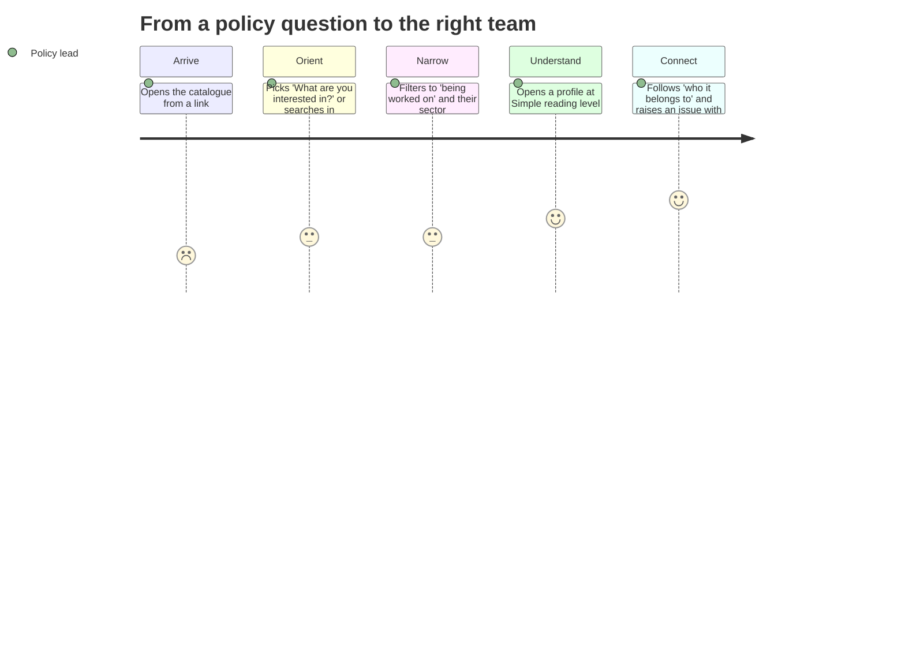
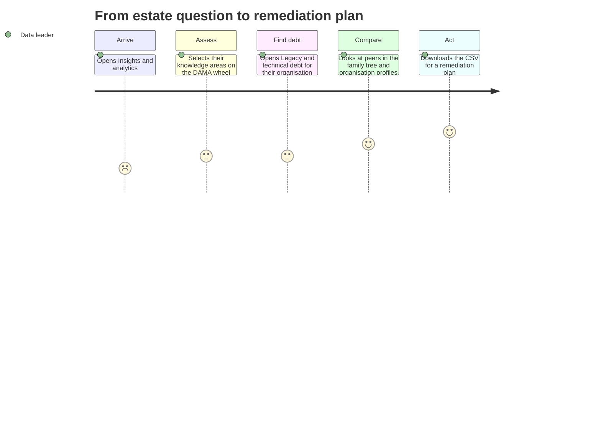
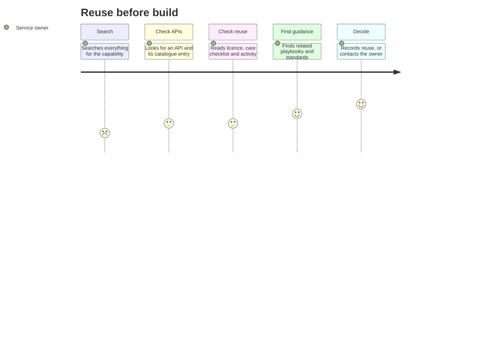
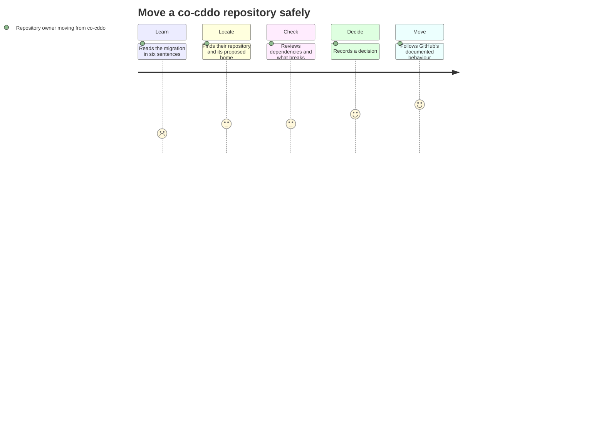
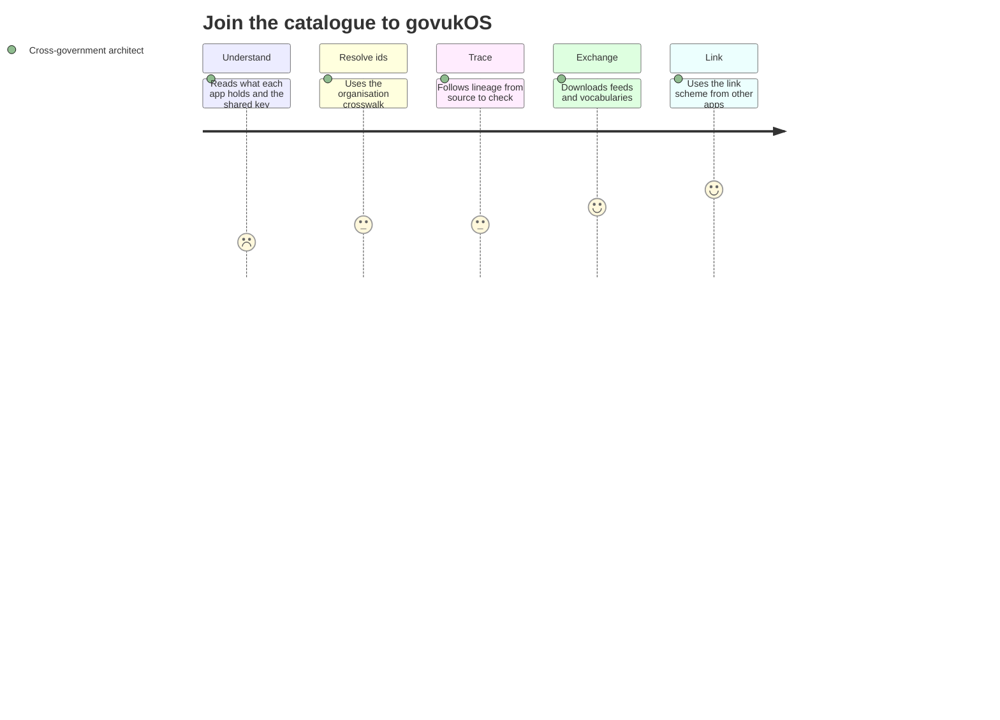
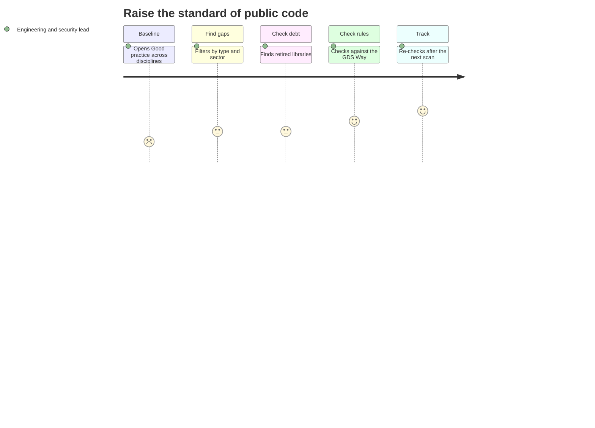

# Journeys

> **Status:** Proto-personas and assumed journeys, written from the requests that shaped the catalogue. Not yet tested with users: research is the first thing to do next.

Scores are assumed feelings (1 to 5), to be tested with users.

## J1: From a policy question to the right team (Policy lead)

| Stage | Action | Page | Feeling |
|---|---|---|---|
| Arrive | Opens the catalogue from a link | home | Curious, unsure |
| Orient | Picks 'What are you interested in?' or searches in everyday words | discover | Relieved: no jargon |
| Narrow | Filters to 'being worked on' and their sector | discover | Focused |
| Understand | Opens a profile at Simple reading level | profile | Confident |
| Connect | Follows 'who it belongs to' and raises an issue with the catalogue's maintainers | family | Ready to act |

**Known pain point:** Most repositories have no description; summaries are written automatically and marked.

## J2: From estate question to remediation plan (Data leader)

| Stage | Action | Page | Feeling |
|---|---|---|---|
| Arrive | Opens Insights and analytics | insights | Wants the big picture |
| Assess | Selects their knowledge areas on the DAMA wheel | dama | Sees gaps |
| Find debt | Opens Legacy and technical debt for their organisation | legacy | Concerned |
| Compare | Looks at peers in the family tree and organisation profiles | family | Benchmarking |
| Act | Downloads the CSV for a remediation plan | legacy | In control |

**Known pain point:** Commercial tools used through their own interfaces leave little trace in public code.

## J3: Reuse before build (Service owner)

| Stage | Action | Page | Feeling |
|---|---|---|---|
| Search | Searches everything for the capability | search | Hopeful |
| Check APIs | Looks for an API and its catalogue entry | apis | Assessing |
| Check reuse | Reads licence, care checklist and activity | profile | Cautious |
| Find guidance | Finds related playbooks and standards | guidance | Reassured |
| Decide | Records reuse, or contacts the owner | profile | Decided |

**Known pain point:** 'Can I reuse it?' is often 'Not known' because licences aren't detected.

## J4: Move a co-cddo repository safely (Repository owner moving from co-cddo)

| Stage | Action | Page | Feeling |
|---|---|---|---|
| Learn | Reads the migration in six sentences | start | Wary |
| Locate | Finds their repository and its proposed home | repos | Clear |
| Check | Reviews dependencies and what breaks | lineage | Careful |
| Decide | Records a decision | repos | Committed |
| Move | Follows GitHub's documented behaviour | safe | Done |

**Known pain point:** Pages and links don't redirect; OIDC subjects change.

## J5: Join the catalogue to govukOS (Cross-government architect)

| Stage | Action | Page | Feeling |
|---|---|---|---|
| Understand | Reads what each app holds and the shared key | govukos | Mapping |
| Resolve ids | Uses the organisation crosswalk | govukos | Unblocked |
| Trace | Follows lineage from source to check | knowledge | Trusting |
| Exchange | Downloads feeds and vocabularies | knowledge | Integrating |
| Link | Uses the link scheme from other apps | govukos | Joined up |

**Known pain point:** The other apps don't yet accept an organisation in their links.

## J6: Raise the standard of public code (Engineering and security lead)

| Stage | Action | Page | Feeling |
|---|---|---|---|
| Baseline | Opens Good practice across disciplines | practice2 | Measuring |
| Find gaps | Filters by type and sector | practice2 | Specific |
| Check debt | Finds retired libraries | legacy | Prioritising |
| Check rules | Checks against the GDS Way | gdsway | Assuring |
| Track | Re-checks after the next scan | practice2 | Improving |

**Known pain point:** A file shows a practice is set up, not how well it's followed.
