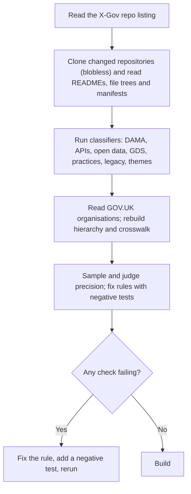
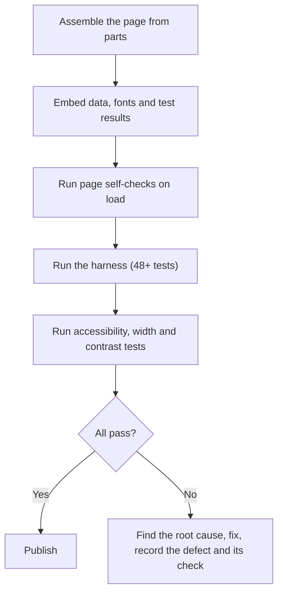
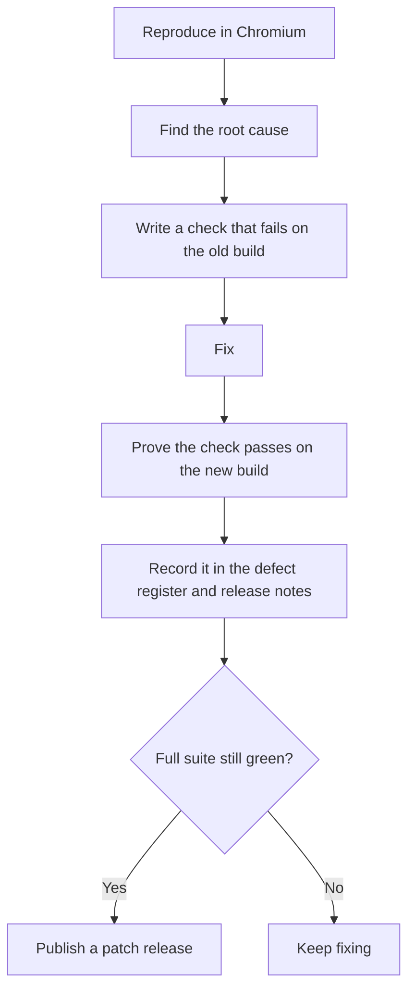
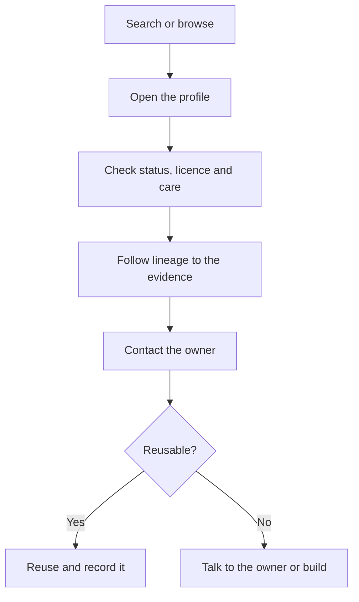
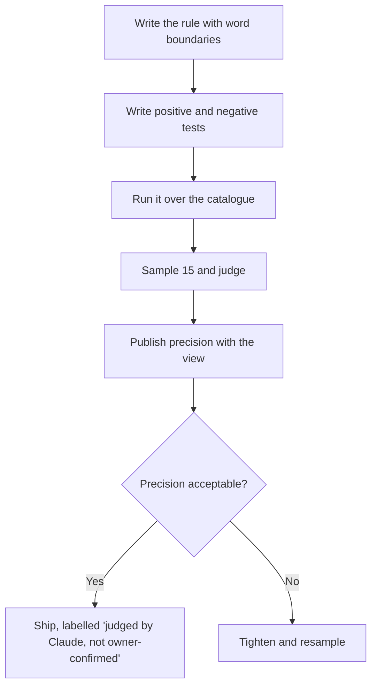
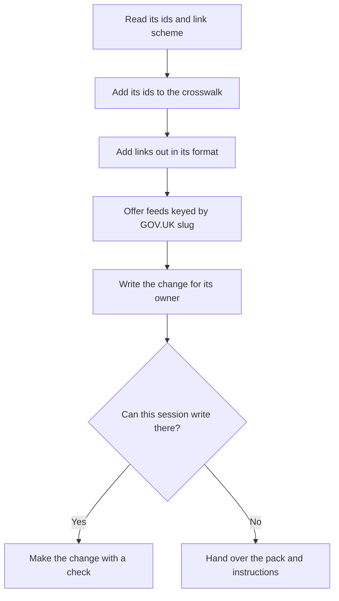

# Processes and workflows

## W1: Refresh the data

## W2: Build and verify

## W3: Handle a reported defect

## W4: Answer a user question with the catalogue

## W5: Add a new classification

## W6: Integrate another govukOS app

